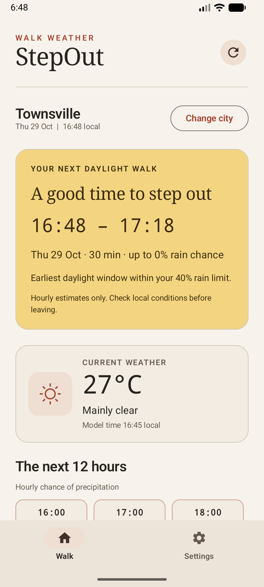
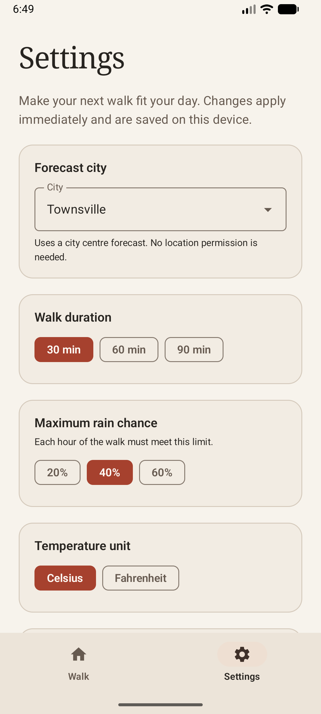
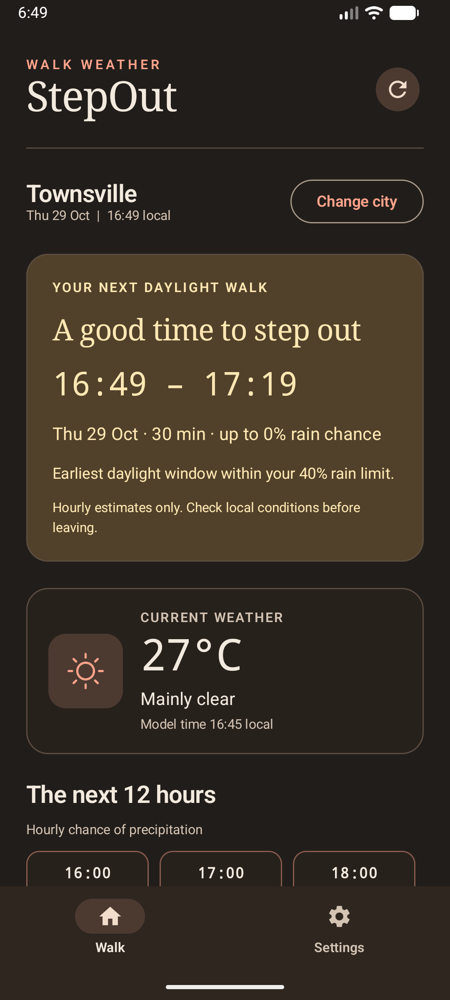

# StepOut

**CP3406 Mobile Computing · Assignment 1 Utility App**
**Penghan Chen · 14758250**

StepOut answers one everyday question: **when can I take my next daylight walk with a rain chance I am comfortable with?** The main screen presents the earliest suitable window, current weather and a compact hourly outlook. Two destinations, Walk and Settings, retain the starter template's single-activity structure.

## Features

- A 30-, 60- or 90-minute daylight walk suggestion within the next 12 hours.
- Maximum hourly precipitation probability of 20%, 40% or 60%, selected by the user.
- City-centre forecasts for Townsville, Cairns, Brisbane, Sydney and Singapore.
- Current modelled temperature and conditions, plus the next 12 hourly intervals.
- Celsius or Fahrenheit and system, light or dark appearance.
- Preferences saved using SharedPreferences; changes apply immediately.
- Automatic initial loading, manual refresh, foreground refresh after 30 minutes, retry and explicit failure states.
- Same-city last successful data remains visible after a failed refresh. Changing city clears the old city's forecast. A request version guard prevents a delayed response from replacing a newer city's data.
- A warning after 30 minutes and suppression of walk suggestions after one hour without a successful update.
- City-local dates and times, edge-to-edge layout, scrollable content and settings that wrap on narrow displays.

## Open and run

1. Clone this repository or extract the project archive.
2. Open the directory containing `settings.gradle.kts` in a current Android Studio version supporting Android Gradle Plugin 8.13.2.
3. Use JDK 17 or later (verified with JDK 21). Install Android SDK Platform 36 and accept the SDK licences. Gradle installs its required Build Tools when allowed.
4. Allow Gradle sync to download dependencies. The supplied wrapper uses Gradle 8.13.
5. Select an Android device or emulator running **Android 8.0 / API 26 or later** and run the `app` configuration. Internet access is needed for weather.

No API key, account or location permission is required. Only the normal `INTERNET` permission is declared. Network requests use HTTPS.

From a terminal with the JDK and SDK configured:

```sh
./gradlew testDebugUnitTest assembleDebug lintDebug
```

On Windows, use `gradlew.bat` instead. Android Studio maintains the machine-specific `local.properties` file; it is intentionally excluded from version control and the source archive. The debug APK is generated at `app/build/outputs/apk/debug/app-debug.apk`.

## Use the app

The initial forecast is for Townsville. Read **Your next daylight walk** for the suggested start and end times, duration and highest hourly rain probability. The displayed date and all forecast times refer to the selected city's timezone. Swipe the hourly row horizontally to view later intervals. Use Refresh to request updated data.

Open **Settings** to choose a city, duration, maximum rain chance, temperature unit or theme. Changes are saved immediately. A different city triggers a new forecast; other changes recalculate or reformat the current forecast without another request. Return using Walk or Android Back.

If no fully covered daylight window meets the limit, the main card says so. Missing rain data is never treated as zero. If a request fails, use Try again after checking connectivity. Previously loaded weather is held only in memory and is not available after a process restart until another request succeeds.

## Architecture and implementation

The application extends the provided MobileTech Utility App starter's Compose scaffold, `UtilityApp`, `UtilityScreen` and `SettingsScreen`. It keeps a single activity and bottom navigation without adding a navigation framework.

```text
MainActivity / UtilityApp
    -> UtilityViewModel (StateFlow<UtilityUiState>)
        -> ForecastRepository -> OpenMeteoRepository -> Retrofit WeatherApi
        -> SettingsRepository -> PreferenceSettingsRepository
UtilityApplication -> AppContainer supplies repositories and Clock
```

- **UI:** stateless screen functions render immutable state and report events. `collectAsStateWithLifecycle` collects state only when the activity is active; `rememberSaveable` retains the selected destination during recreation. The screens use Material 3 typography, cards, navigation and accessible labelled controls.
- **State:** `UtilityViewModel` owns network jobs, errors, refresh logic and the minute ticker. Its lifetime survives rotation. Clock injection and repository interfaces allow deterministic testing.
- **Dependency injection:** `AppContainer` is the application-scoped composition root. It creates Retrofit, OkHttp, repositories and a clock, and the ViewModel factory injects them through constructors. No service construction occurs inside composables.
- **Data:** Retrofit suspend functions perform asynchronous calls. A validating mapper separates nullable transport data from domain models. Timeouts are bounded and cancellation is propagated.
- **Domain:** `findWalkWindow` is a pure Kotlin function independent of Android and UI classes.

### Window selection

The planner tries the current instant followed by future hourly interval starts. It returns the first candidate whose entire walk ends within the 12-hour horizon and is covered by contiguous daylight forecast intervals, each with a known probability at or below the chosen limit. It does not search every possible minute or optimise comfort, heat or wind.

Open-Meteo's precipitation probability at timestamp `t` describes the **preceding hour**. The mapper therefore pairs it with interval `[t - 1 hour, t)`, using temperature, weather code and daylight from the interval start. The API uses Unix timestamps, avoiding ambiguous local timestamps across daylight saving changes. API timezone identifiers control display formatting.

The displayed window probability is the **maximum hourly probability**, not the probability of rain over the entire walk. Daylight is inferred from hourly `is_day`, so sunrise and sunset boundaries are approximate. Forecasts are estimates rather than observations or alerts. The app is a simple planning aid; users should check actual local conditions before leaving.

### API and attribution

Endpoint: `https://api.open-meteo.com/v1/forecast`

Parameters include selected city latitude/longitude, `timezone=auto`, `timeformat=unixtime`, `forecast_days=2`, current `temperature_2m,weather_code,is_day` and hourly `temperature_2m,precipitation_probability,weather_code,is_day`.

Weather data is provided by [Open-Meteo](https://open-meteo.com/) under [CC BY 4.0](https://creativecommons.org/licenses/by/4.0/). Its source and licence are also linked in the app. The free endpoint is suitable for this non-commercial educational project. Requests disclose the selected city's coordinates and the connection's IP address to the provider; no GPS coordinates are collected. Preferences contain no account details. There are no advertising or analytics SDKs.

## Project contents

| Path | Purpose |
| --- | --- |
| `app/src/main/java/.../MainActivity.kt` | Activity, lifecycle integration and two-tab scaffold |
| `app/src/main/java/.../UtilityApplication.kt` | Application and dependency container |
| `app/src/main/java/.../UtilityViewModel.kt` | Observable state, requests, refresh and errors |
| `app/src/main/java/.../domain/` | Settings, cities, forecast models and walk selection |
| `app/src/main/java/.../data/` | Retrofit API, response models, validation and repositories |
| `app/src/main/java/.../ui/` | Main screen, settings screen, source links and theme |
| `app/src/main/res/` | Application name, Android theme, icon and backup resources |
| `app/src/test/` | Deterministic planner, mapping, ViewModel and Compose tests |
| `app/src/androidTest/` | Device instrumentation smoke test |
| `app/build.gradle.kts` | Android configuration and dependencies |
| `gradle/libs.versions.toml` | Starter dependency version catalogue |
| `gradle/wrapper/`, `gradlew`, `gradlew.bat` | Reproducible Gradle wrapper |
| `build.gradle.kts`, `settings.gradle.kts`, `gradle.properties` | Root build and repository configuration |
| `docs/VERIFICATION.md` | Executed checks, results and remaining device verification |

The project keeps the starter's package and application ID `au.edu.jcu.assessment.utilityapp`, compile/target SDK 36 and minimum SDK 26. Kotlin is the implementation language; XML and Gradle Kotlin DSL supply Android resources and build configuration.

## Verification

Run `testDebugUnitTest` for deterministic domain, repository, ViewModel and Robolectric Compose tests. These tests use fake data and require no live weather service. Run `lintDebug` for Android static checks and `assembleDebug` to build the installable package. A first Robolectric run downloads its Android runtime from Maven Central.

Run `connectedDebugAndroidTest` with a connected device or booted emulator. All three device tests passed on the hardware-accelerated Android 17 / API 37 emulator. Live loading, offline failure and recovery, settings after a process restart, rotation, large text and system bars were also checked. See [the verification record](docs/VERIFICATION.md) for the tested environment and compatibility limits. Physical hardware and API 26 have not been tested.

## References

- [Open-Meteo Forecast API documentation](https://open-meteo.com/en/docs)
- [Android architecture recommendations](https://developer.android.com/topic/architecture/recommendations)
- [State and Jetpack Compose](https://developer.android.com/develop/ui/compose/state)
- [Compose semantics](https://developer.android.com/develop/ui/compose/accessibility/semantics)
- [Retrofit official documentation](https://square.github.io/retrofit/)
- [Robolectric getting started](https://robolectric.org/getting-started/)

Starter attribution: MobileTech Utility App, supplied for CP3406 Assessment 1. The original scaffold and Gradle project were retained and extended for StepOut. No third-party application source was copied.

## Screen previews

These are actual screenshots of StepOut running on the Android 17 / API 37 emulator with live Open-Meteo data on 29 October 2026. The local Robolectric screenshot test separately renders deterministic fixtures into `app/build/reports/screenshots/`.

| Walk in light mode | Settings | Walk in dark mode |
| --- | --- | --- |
|  |  |  |
